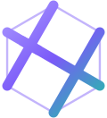

<div align="center">



# polyweave

**A Claude Code plugin that makes a game's parts: you declare what each part must satisfy, and it searches Blender, Godot and the generators for the parameters that pass.**

```
pip install polyweave-gamekit
```

then, inside Claude Code:

```
/plugin marketplace add alegauss/polyweave
/plugin install polyweave@polyweave
```

No account, no hosted service · runs on your machine, against files in your own repository

**[alegauss.github.io/polyweave](https://alegauss.github.io/polyweave/)**: the site. Every
page has an `index.md` twin, so an agent can read it as text.

</div>

- **A bar instead of an opinion.** Each part gets an acceptance spec (`<asset>.accept.toml`):
  named predicates over measurements such as silhouette, colour at a percentile, contrast,
  loudness and loop seams. A render is checked against the spec, not judged by eye.
- **A search instead of a person turning knobs.** `search.sweep` turns only the parameters
  the spec permits, spends a stated number of renders, and returns a contact sheet and a
  trace of how close each candidate came.
- **A person still says yes.** Candidates go to a review page in your browser, and the call
  waits for your answer. The agent never accepts its own look.
- **Money only when you said so.** A paid generator (Meshy, Ideogram, ElevenLabs, ...)
  spends only inside a budget you write in `polyweave.toml`, and every spend is quoted and
  kept in a ledger.
- **Every layer of a game.** 3D models, pictures, sprites, music, sound effects, voices,
  visual effects, the world's names and lines, levels, and driving the running game
  headless in Godot.

---

> **Unofficial / community project.** Not affiliated with, endorsed by, or sponsored by
> Anthropic. "Claude" and "Claude Code" are trademarks of Anthropic.

## Install

You need **Python 3.11 or newer** on `PATH`, as `python`: the plugin starts its MCP server
and its hooks with `python -m polyweave`, so the package has to be importable by that
interpreter.

1. Install the package. On PyPI it is **`polyweave-gamekit`**, because `polyweave` there is
   an unrelated project; the import, the `polyweave` command and the plugin keep the short
   name.

   ```
   pip install polyweave-gamekit
   ```

2. Add the marketplace and install the plugin, inside Claude Code:

   ```
   /plugin marketplace add alegauss/polyweave
   /plugin install polyweave@polyweave
   ```

3. Restart Claude Code, then check what this machine can do:

   ```
   python -m polyweave capabilities
   ```

   It says whether Blender, Godot and the other optional tools were found, and why not
   when they were not.

The plugin brings three things: the `polyweave` MCP server, the `polyweave` skill that
teaches Claude Code to drive it, and hooks that keep an agent from hand-editing a file the
plugin built or recorded (it is told which declaration to change and which build to run
instead).

### Optional tools

Nothing below is needed to install. An operation that needs a missing tool refuses by name
and says what to install.

| For | Install |
|---|---|
| Rendering 3D | [Blender](https://www.blender.org/) 4.2+, on `PATH` or named in `[paths] blender`, or `pip install "polyweave-gamekit[blender]"` |
| Driving the game, capturing screens | [Godot](https://godotengine.org/) 4, on `PATH` or named in `[paths] godot` |
| Rendering a score | `pip install "polyweave-gamekit[audio]"` (Surge XT through Pedalboard) |
| Splitting a track into stems | `pip install "polyweave-gamekit[stems]"` (Demucs; CPU torch is enough) |
| Outlining text in an SVG | `pip install "polyweave-gamekit[text]"` |
| Reading lettering off a picture | [Tesseract](https://github.com/tesseract-ocr/tesseract) |

## First session

Open Claude Code in your game's repository and ask for the setup:

> Set this project up for polyweave.

Claude runs `init`, which proposes a `polyweave.toml` for the repository and writes it once
you agree. That file holds everything the plugin would otherwise have to guess: where meshes,
references, renders and specs live, the render rungs, the paths to Blender and Godot, and
the budget. An unknown key is refused with the nearest match named, never ignored. Starting
from nothing? Ask for a new game instead, and `project.new` creates a Godot project with the
kits you name (input, menus, options, saves, tests).

Then ask for parts the way you would ask a person:

> Make the crate model in `tools/art/3d/crate` pass its spec, and show me the candidates.

> Check every committed render against its accept spec.

> Loop the rain ambience so the seam can't be heard, and measure its loudness.

> Check that every line the player reads uses the names declared in `world.toml`.

Claude starts with `asset.brief`, which says where a part stands in one read, then builds,
searches and checks. When only taste can answer, it puts a review sheet in your browser and
waits for you. To open that page yourself, run `python -m polyweave review`.

### Paid generators

A paid service is used only with a key and a budget, both set by you:

```toml
# polyweave.toml
[service.meshy]
key_env = "MESHY_API_KEY"   # the NAME of the environment variable, never the key itself

[budget.meshy]
amount  = 60
unit    = "credits"
expires = "2026-12-31"
```

Without a budget, or once it expires, a paid call is refused. `purchase.remaining` says what
is left, and every artefact records the model, prompt, seed, cost and licence that made it,
which is where the game's credits are written from.

## Without Claude Code

Every operation the MCP server exposes is also a command line, with the same names and
parameters:

```
python -m polyweave describe                         # every operation, its parameters and ranges
python -m polyweave accept.check --spec crate.accept.toml --subject crate.png
python -m polyweave search.sweep --spec crate.accept.toml --out crate.png
```

A refusal carries a stable `code` and a `remedy` naming the call that fixes it.

## Status

What is still open is in [`docs/ROADMAP.md`](docs/ROADMAP.md), block by block, and what has
shipped is in [`docs/CHANGELOG.md`](docs/CHANGELOG.md). The status is not typed here because
a typed status goes stale; the site states it, counted from the roadmap. Every line in the
roadmap was drawn from a failure measured in a real game, and the roadmap also lists the
non-goals: what polyweave deliberately will not be.

No number anywhere is yet a measurement of polyweave itself. That is Block H, where a real
game adopts the plugin and the loop ledger records what a part cost to make each way.

## Developing polyweave

Python under `src/polyweave`, against Python 3.11, which is the interpreter Blender 4.2
ships, so code here may have to run inside it. The core depends on numpy and Pillow and
nothing else.

```
pip install -e ".[dev]"
python tools/gate.py     # the suite, in tests/, under a lock, stamped
python -m ruff check .   # the linter
python -m ruff format .  # the formatter
```

- `plugin/` is what Claude Code installs: the manifest, the hooks and `skills/polyweave/`.
  `.claude-plugin/marketplace.json` names it.
- `docs/specs/` holds the contracts more than one roadmap line depends on: the tool surface,
  the project config, the measurement vocabulary, the acceptance spec and the rest. They are
  ordinary documents, edited directly.
- `docs/ROADMAP.md`, `docs/CHANGELOG.md` and `docs/IMPROVEMENTS.md` belong to
  [roadkeep](https://github.com/alegauss/roadkeep) and are not edited by hand.
- `site/` is the public page. Its status is generated from the roadmap, and `npm test` fails
  the build when the two disagree. See [`site/README.md`](site/README.md).
- A `v<version>` tag publishes the package through `.github/workflows/publish.yml`, to
  TestPyPI first and then PyPI. The version is `polyweave.__version__`, and the plugin
  manifest carries the same number.

## More tools by alegauss

For Claude Code:

- **[Claude Code Tray](https://alegauss.github.io/claude-tray/)**: your rate-limit usage as a Windows tray icon that turns red before you run out.
- **[roadkeep](https://alegauss.github.io/roadkeep/)**: keeps ROADMAP, CHANGELOG and IMPROVEMENTS to one format, as a CLI and a Claude Code plugin.
- **[commitclerk](https://alegauss.github.io/commitclerk/)**: Conventional Commits messages from your staged diff, in a single-file Python CLI.

For Windows developers:

- **[winwright](https://alegauss.github.io/winwright/)**: drives a Windows desktop app from a test and reports what was actually observed.
- **[FreeWilly](https://alegauss.github.io/freewilly/)**: Docker on Windows without Docker Desktop, with no admin prompt and no telemetry.
- **[Quickshell](https://alegauss.github.io/quickshell/)**: an SSH client for Windows with sessions, keys, SFTP and tunnels, and without the rest of the suite.

All of them: [alegauss.github.io](https://alegauss.github.io/)
